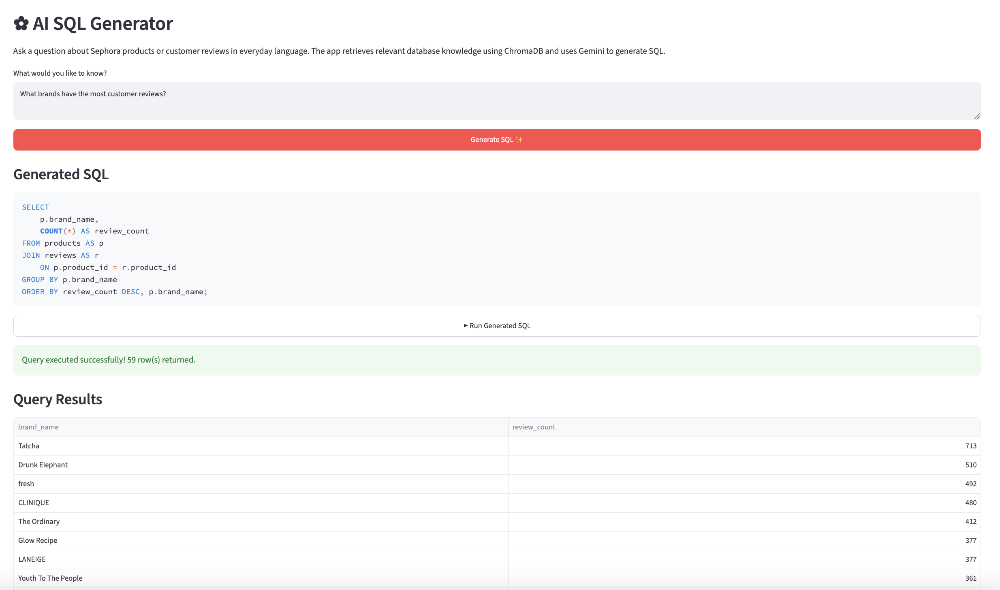

# ✿ Sephora SQL Lab

[](https://github.com/tientle/sql-quiz/actions/workflows/tests.yml)


An interactive SQL learning application built with Python, Streamlit, Supabase PostgreSQL, ChromaDB, and Google Gemini.

Sephora SQL Lab allows students to practice SQL using real-world Sephora product and customer review data. Users can answer interview-style SQL questions, execute queries against a hosted PostgreSQL database, and save their work.

The application also includes a **RAG-powered AI SQL Generator** that translates natural-language questions into PostgreSQL queries using retrieved database knowledge.

## Live Application and Repository

- **Live Application:** [Sephora SQL Lab](https://sephora-sql-quiz.streamlit.app/)
- **GitHub Repository:** [tientle/sql-quiz](https://github.com/tientle/sql-quiz)
- **GitHub Actions:** [View Workflow Runs](https://github.com/tientle/sql-quiz/actions)

### Grader Access

The application requires authentication.

A dedicated account has been created for assignment evaluation.

- **Email:** `grader@example.com`
- **Password:** Provided separately through the private Canvas submission
- **Registration:** Not required

The grader can sign in, access the five SQL questions, use the AI SQL Generator, execute SQL queries, and inspect the retrieved knowledge.

The password is intentionally excluded from this public repository.

---

## 1. Project Overview

The project began as an interactive SQL assessment environment similar to a classroom exercise or technical interview.

Rather than working with static SQL examples, students execute queries against a live PostgreSQL database containing Sephora product and customer review data.

For the Week 8 extension, the application incorporates **Retrieval-Augmented Generation (RAG)** to support natural-language Text-to-SQL generation.

### Key Features

- Hosted PostgreSQL database with Sephora products and reviews
- Supabase authentication and persistent answer storage
- Five SQL quiz questions worth 20 points
- Interactive SQL editor and live query results
- Database schema reference and conceptual hints
- ChromaDB vector similarity retrieval
- Google Gemini API integration
- Natural-language to PostgreSQL SQL generation
- Optional execution of AI-generated SQL
- Expandable view of retrieved knowledge documents
- GitHub Actions automated testing
- Streamlit Community Cloud deployment

---

## 2. Hosted PostgreSQL Database

### 2.1 Database Hosting

The application uses PostgreSQL hosted on Supabase.

The Streamlit application connects using Python's `psycopg2` library through the Supabase Session Pooler with SSL enabled.

### 2.2 Dataset Overview

The project uses the Kaggle Sephora Products and Skincare Reviews dataset.

A subset of the original data was loaded into PostgreSQL.

| Table      |   Rows | Description                                               |
| ---------- | -----: | --------------------------------------------------------- |
| `products` |  8,494 | Product names, brands, prices, ratings, and categories    |
| `reviews`  | 10,000 | Sampled customer reviews, recommendations, and skin types |

The database supports joins, aggregations, subqueries, and window functions.

### 2.3 Database Schema

#### Products Table

| Column               | Data Type     | Description                |
| -------------------- | ------------- | -------------------------- |
| `product_id`         | TEXT          | Primary key                |
| `product_name`       | TEXT          | Product name               |
| `brand_name`         | TEXT          | Product brand              |
| `price_usd`          | NUMERIC(10,2) | Product price              |
| `rating`             | NUMERIC       | Product rating             |
| `loves_count`        | INTEGER       | Number of user loves       |
| `primary_category`   | TEXT          | Primary product category   |
| `secondary_category` | TEXT          | Secondary product category |
| `sephora_exclusive`  | BOOLEAN       | Sephora exclusivity        |

#### Reviews Table

| Column            | Data Type | Description             |
| ----------------- | --------- | ----------------------- |
| `review_id`       | BIGINT    | Primary key             |
| `product_id`      | TEXT      | Foreign key to products |
| `author_id`       | TEXT      | Reviewer identifier     |
| `rating`          | INTEGER   | Customer rating         |
| `is_recommended`  | BOOLEAN   | Product recommendation  |
| `submission_time` | DATE      | Review submission date  |
| `review_text`     | TEXT      | Written review          |
| `skin_type`       | TEXT      | Customer skin type      |

### 2.4 Table Relationships

The database has a one-to-many relationship between products and reviews.

Each product can have multiple reviews. The tables are connected through `product_id`.

Example:

```sql
SELECT
    p.brand_name,
    COUNT(*) AS review_count
FROM reviews AS r
JOIN products AS p
    ON r.product_id = p.product_id
GROUP BY p.brand_name
ORDER BY review_count DESC;
```

This query calculates the number of sampled reviews for each brand.

### 2.5 SQL Execution and Security

The `database.py` module manages database connections, SQL validation, and query execution.

The application uses a restricted PostgreSQL role named `quiz_reader`, which has SELECT permissions on the product and review tables.

Additional safeguards include:

- Read-only transactions
- Five-second statement timeout
- SQL validation using `pglast`
- Limits on returned result rows
- Credentials stored outside the source code

The same query execution function is reused for AI-generated SQL.

AI-generated SQL is treated as untrusted input. Read-only permissions and SQL validation reduce risk but do not provide complete isolation for arbitrary SQL execution.

---

## 3. RAG-Powered AI SQL Generator

### 3.1 Overview

The Week 8 extension adds a natural-language interface for generating PostgreSQL queries.

Users can enter questions such as:

> Which brands have the most customer reviews?

Instead of relying only on the language model's general knowledge, the application retrieves relevant database information from ChromaDB and includes it in the model's prompt.

Gemini then generates SQL using the retrieved context.

### 3.2 RAG Architecture

```text
          Natural-Language Question
                     |
                     v
            ChromaDB Retrieval
           (Vector Similarity)
                     |
                     v
        Relevant Knowledge Documents
          - Database schemas
          - Table relationships
          - Business rules
          - Example SQL queries
                     |
                     v
            Prompt Construction
                     |
                     v
             Google Gemini API
                     |
                     v
           Generated PostgreSQL SQL
                     |
                     v
             Streamlit Interface
                     |
                     v
          Optional SQL Execution
                     |
                     v
           Supabase PostgreSQL
                     |
                     v
                Results Table
```

### 3.3 Vector Database: ChromaDB

The application uses ChromaDB as a persistent vector database.

The knowledge base contains nine documents:

| Document Type       | Count | Purpose                            |
| ------------------- | ----: | ---------------------------------- |
| Products schema     |     1 | Describes product columns          |
| Reviews schema      |     1 | Describes review columns           |
| Table relationships |     1 | Explains joins and relationships   |
| Business rules      |     1 | Explains data interpretation       |
| SQL quiz examples   |     5 | Provides question-and-SQL examples |
| **Total**           | **9** |                                    |

The knowledge base is created by `build_knowledge_base.py`.

ChromaDB stores document embeddings and supports semantic similarity search.

When a user submits a question, the application retrieves the four most relevant documents.

The retrieved documents are included in the prompt sent to Gemini.

This satisfies the vector retrieval requirement: the application performs an actual similarity search rather than simply appending the entire database schema to every prompt.

### 3.4 AI API: Google Gemini

The application uses Google's Gemini API through its OpenAI-compatible endpoint.

The API client is configured in `rag.py`.

The model receives:

1. A system instruction describing the SQL-generation task.
2. Retrieved database knowledge from ChromaDB.
3. The user's natural-language question.

The system prompt instructs Gemini to:

- Generate PostgreSQL SQL.
- Use documented tables and columns.
- Avoid inventing database fields.
- Return read-only SELECT queries.
- Avoid Markdown formatting and explanations.

The generated SQL is displayed with syntax highlighting in Streamlit.

The Gemini API key and model name are configured through environment variables or deployment secrets.

### 3.5 End-to-End RAG Demonstration

Example user question:

> Which brands have the most customer reviews?

Example generated SQL:

```sql
SELECT
    p.brand_name,
    COUNT(*) AS review_count
FROM products AS p
JOIN reviews AS r
    ON p.product_id = r.product_id
GROUP BY p.brand_name
ORDER BY review_count DESC;
```

For this type of question, retrieval can surface the table relationships, review schema, and relevant SQL examples.

The generated SQL can then be executed against the hosted PostgreSQL database.

The application also provides a **View Retrieved Knowledge** expander showing the retrieved document IDs, text, and vector distances.

### 3.6 Optional SQL Execution

The application extends the core Text-to-SQL workflow by allowing users to execute generated SQL.

After generating a query, users can click **Run Generated SQL**.

The application:

1. Retrieves the generated SQL from Streamlit session state.
2. Sends the query to the existing database execution function.
3. Applies the database runner's read-only safeguards.
4. Displays the returned results in a Streamlit table.

This implements the optional SQL execution feature.



---

## 4. Authentication and Answer Persistence

### 4.1 Supabase Authentication

The application uses Supabase Auth for email/password authentication.

Users must sign in before accessing the quiz or AI SQL Generator.

### 4.2 Answer Storage

Saved quiz answers are stored in the Supabase `quiz_answers` table.

| Column        | Description                 |
| ------------- | --------------------------- |
| `id`          | Unique answer identifier    |
| `user_id`     | Authenticated user's ID     |
| `question_id` | Corresponding quiz question |
| `sql_answer`  | Saved SQL query             |
| `updated_at`  | Record update timestamp     |

A unique constraint on `(user_id, question_id)` allows users to update their saved answers.

Row Level Security policies restrict users to accessing their own answers.

### 4.3 Persistence

When users click **Save Answer**, their SQL is stored in Supabase.

Previously saved answers are loaded when users sign in again.

The AI SQL Generator uses Streamlit session state to preserve generated SQL and execution results during the active session.

---

## 5. SQL Quiz

### 5.1 Quiz Overview

The quiz contains five questions worth four points each, totaling 20 points.

| Question                                 | Difficulty  | SQL Concepts                       | Points |
| ---------------------------------------- | ----------- | ---------------------------------- | -----: |
| Finding Products Without Reviews         | Easy        | NOT EXISTS, correlated subqueries  |      4 |
| Identifying Highly Reviewed Brands       | Easy–Medium | JOIN, GROUP BY, HAVING             |      4 |
| Comparing Recommendations by Skin Type   | Medium      | CASE WHEN, conditional aggregation |      4 |
| Calculating Brand Recommendation Rates   | Medium–Hard | Aggregation, percentages, NULLIF   |      4 |
| Finding the Top Product in Each Category | Hard        | CTEs, ROW_NUMBER, window functions |      4 |
| **Total**                                |             |                                    | **20** |

Questions are defined in `questions.py`.

### 5.2 Question Structure

Each question contains a title, difficulty, point value, business scenario, SQL requirements, conceptual hint, reference solution, and expected result description.

### 5.3 Using the Quiz

1. Open the deployed Streamlit application.
2. Sign in using an existing account.
3. Select a question from the dropdown.
4. Review the database schema in the sidebar.
5. Write SQL in the editor.
6. Click **Run Query** to execute it.
7. Review the returned results.
8. Click **Save Answer** to persist the query.

The application supports hints and expected-output descriptions.

Quiz answers are not automatically graded.

### 5.4 Using the AI SQL Generator

1. Sign in to Sephora SQL Lab.
2. Scroll to **AI SQL Generator**.
3. Enter a natural-language question about Sephora products or reviews.
4. Click **Generate SQL**.
5. Review the generated PostgreSQL query.
6. Expand **View Retrieved Knowledge** to inspect the retrieved documents.
7. Optionally click **Run Generated SQL** to execute the query and view its results.

---

## 6. GitHub Actions and Testing

### 6.1 Continuous Integration

The project uses GitHub Actions for automated testing.

Workflow:

```text
.github/workflows/tests.yml
```

[View GitHub Actions](https://github.com/tientle/sql-quiz/actions)

### 6.2 Automated Tests

The existing workflow checks:

- Python application compilation
- Quiz question structure
- Five questions totaling 20 points
- Unique question IDs
- Required question content
- PostgreSQL database connectivity
- Expected product and review row counts

The workflow uses GitHub Repository Secrets for database credentials.

The RAG feature was additionally tested locally by retrieving ChromaDB documents and generating SQL using Gemini.

### 6.3 GitHub Secrets

Database connection secrets include:

- `POSTGRES_DB`
- `DB_HOST`
- `DB_PORT`
- `DB_SSLMODE`
- `QUIZ_DB_USER`
- `QUIZ_DB_PASSWORD`

Secrets are not committed to the repository.

---

## 7. Project Structure

```text
sql-quiz/
├── .github/
│   └── workflows/
│       └── tests.yml
├── screenshots/
│   ├── sql-generation.png
│   ├── retrieved-knowledge.png
│   └── sql-results.png
├── chroma_data/
├── app.py
├── database.py
├── questions.py
├── rag.py
├── build_knowledge_base.py
├── requirements.txt
├── README.md
├── .gitignore
└── .env
```

The `chroma_data/` directory contains the persistent vector database.

The `.env` file stores local credentials and is excluded from GitHub.

### Important Files

| File                          | Purpose                                                     |
| ----------------------------- | ----------------------------------------------------------- |
| `app.py`                      | Streamlit interface, authentication, quiz, and AI generator |
| `database.py`                 | PostgreSQL connections, SQL validation, and execution       |
| `questions.py`                | Quiz questions and reference SQL examples                   |
| `rag.py`                      | Vector retrieval and Gemini SQL generation                  |
| `build_knowledge_base.py`     | Creates and populates ChromaDB                              |
| `chroma_data/`                | Persistent ChromaDB collection                              |
| `requirements.txt`            | Python dependencies                                         |
| `README.md`                   | Project documentation                                       |
| `.github/workflows/tests.yml` | Automated testing                                           |

---

## 8. Local Setup

### 8.1 Prerequisites

- Python 3.11 or a compatible version
- Git
- Configured Supabase PostgreSQL database
- Supabase authentication
- Gemini API key
- Appropriate database permissions

### 8.2 Clone the Repository

```bash
git clone https://github.com/tientle/sql-quiz.git
cd sql-quiz
```

### 8.3 Create a Virtual Environment

On macOS or Linux:

```bash
python3 -m venv .venv
source .venv/bin/activate
```

On Windows:

```powershell
python -m venv .venv
.venv\Scripts\activate
```

### 8.4 Install Dependencies

```bash
pip install -r requirements.txt
```

### 8.5 Configure Environment Variables

Create a `.env` file in the project root.

```dotenv
POSTGRES_DB=postgres
POSTGRES_USER=postgres.YOUR_PROJECT_REF
POSTGRES_PASSWORD=YOUR_DATABASE_PASSWORD

DB_HOST=YOUR_SUPABASE_SESSION_POOLER_HOST
DB_PORT=5432
DB_SSLMODE=require

SUPABASE_URL=YOUR_SUPABASE_PROJECT_URL
SUPABASE_KEY=YOUR_SUPABASE_PUBLISHABLE_KEY

QUIZ_DB_USER=quiz_reader.YOUR_PROJECT_REF
QUIZ_DB_PASSWORD=YOUR_RESTRICTED_ROLE_PASSWORD

GEMINI_API_KEY=YOUR_GEMINI_API_KEY
GEMINI_MODEL=YOUR_AVAILABLE_GEMINI_MODEL
```

Use a Gemini model available to your project's API tier.

The `SUPABASE_KEY` should be a publishable or anonymous client key, not a service-role key.

Never commit `.env` or API keys to GitHub.

### 8.6 Build the Vector Knowledge Base

If `chroma_data/` has not already been initialized, run:

```bash
python build_knowledge_base.py
```

The script indexes the database schemas, relationships, business rules, and SQL examples.

Expected output:

```text
Indexed 9 knowledge documents.
```

### 8.7 Run the Application

```bash
streamlit run app.py
```

The application typically opens at:

```text
http://localhost:8501
```

Sign in to access the SQL quiz and AI SQL Generator.

---

## 9. Deployment

The application is deployed through Streamlit Community Cloud.

| Setting      | Value              |
| ------------ | ------------------ |
| Source       | GitHub repository  |
| Branch       | `main`             |
| Main file    | `app.py`           |
| Dependencies | `requirements.txt` |
| Credentials  | Streamlit Secrets  |

The deployed app connects to Supabase PostgreSQL and the Gemini API.

### Streamlit Secrets

Configure the existing Supabase and PostgreSQL credentials, plus:

```toml
GEMINI_API_KEY = "YOUR_GEMINI_API_KEY"
GEMINI_MODEL = "YOUR_AVAILABLE_GEMINI_MODEL"
```

Credentials must not be committed to GitHub.

The deployed application must also have access to the initialized ChromaDB knowledge collection.

Changes pushed to the configured GitHub branch trigger a Streamlit application update.

---

## 10. Testing and Verification

The following features were tested during development:

- Supabase authentication
- PostgreSQL query execution
- SQL result display
- Saving and retrieving quiz answers
- Database schema reference
- ChromaDB vector retrieval
- Gemini API connectivity
- End-to-end RAG SQL generation
- Generated SQL display in Streamlit
- Retrieved knowledge inspection
- Existing GitHub Actions workflow

Before final submission, the deployed application should also be tested for:

- Successful initialization of ChromaDB
- Gemini SQL generation from the public Streamlit URL
- Execution of AI-generated SQL
- Grader account access

---

## 11. Limitations and Future Improvements

### Current Limitations

- The reviews table contains 10,000 sampled reviews.
- AI-generated SQL may be inaccurate.
- SQL generation depends on Gemini API availability and rate limits.
- The AI SQL Generator does not automatically validate correctness against reference results.
- Read-only permissions and SQL validation do not provide complete isolation for arbitrary SQL execution.
- The SQL quiz does not automatically grade saved answers.

### Future Improvements

- Automatic correctness comparison using expected SQL results
- Additional few-shot SQL examples
- Expanded database documentation and business semantics
- More SQL questions and difficulty levels
- Retrieval quality evaluation
- SQL generation latency optimization
- Instructor-facing analytics
- Stronger SQL execution isolation
- Query execution audit logging

---

## 12. Data Source

**Dataset:** Kaggle Sephora Products and Skincare Reviews

The dataset is used for educational SQL practice and analysis.

---
